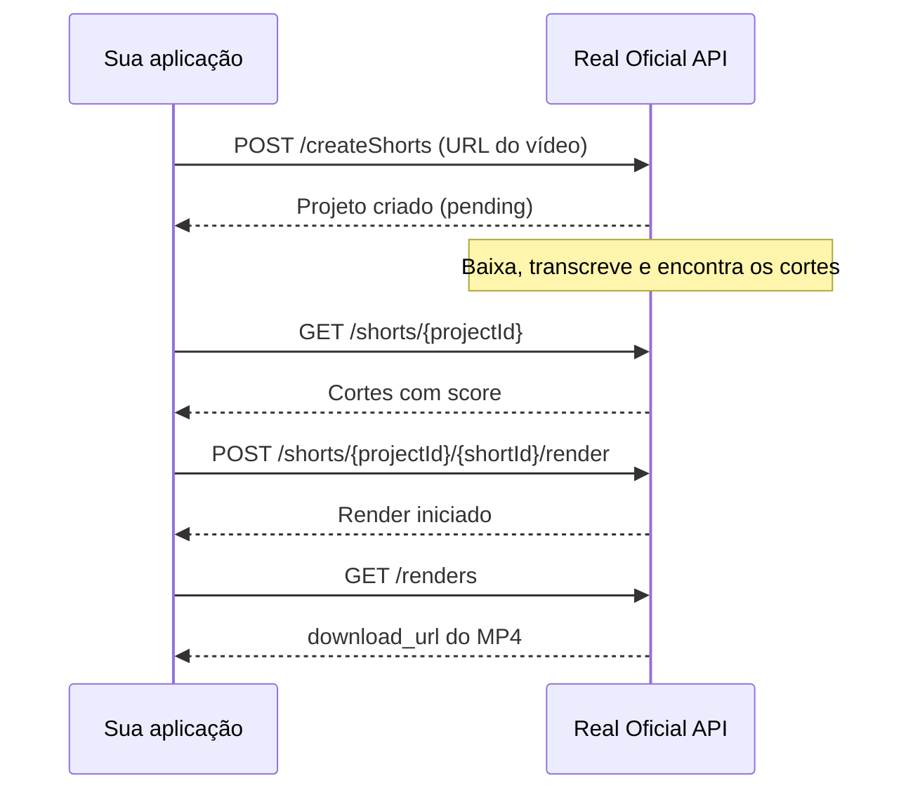

<Frame>
  
</Frame>

A API da Real Oficial recebe um vídeo longo, encontra os melhores momentos, gera os
cortes, renderiza os arquivos e publica nas redes sociais. Tudo o que está nesta
documentação pode ser chamado da sua aplicação com um Bearer Token.

Qualquer conta pode usar a API, inclusive a gratuita. O que muda entre os planos são os
créditos e os limites de cada operação. Veja [Créditos e planos](/plans).

<CardGroup cols={2}>
  <Card title="Quickstart" icon="rocket" href="/quickstart">
    Do link de um vídeo ao primeiro corte renderizado, em quatro chamadas.
  </Card>
  <Card title="Autenticação" icon="key" href="/authentication">
    Onde pegar o token e como enviá-lo.
  </Card>
</CardGroup>

## Como a API funciona

Quase toda operação pesada é assíncrona: você cria o pedido, acompanha o status e usa o
resultado quando ele fica pronto.

Para acompanhar, consulte o endpoint de status em intervalos ou configure um
[webhook](/api-reference/auth/profile#webhooks) para ser avisado quando um projeto ou um
render termina.

## O que dá para fazer

| Área | O que faz | Comece por |
|---|---|---|
| Cortes | Cria projetos a partir de um vídeo, lista e edita os cortes, renderiza os MP4 | [Criar Projeto com IA](/api-reference/projects/create) |
| IA | Auto Edit, dublagem, tradução de legendas, geração de imagem e vídeo, avatares e thumbnails | [Auto Edit](/api-reference/auto-edit) |
| Publicação | Conecta contas sociais, publica, agenda e organiza filas de postagem | [Publicações e Agendamento](/api-reference/social-posts) |
| Conteúdo | Brand kits, templates, biblioteca de arquivos e prompts, uploads de mídia | [Biblioteca](/api-reference/library) |
| Lives | Monitora lives da Twitch e da Kick e lista os cortes gerados a partir delas | [Iniciar Monitoramento](/api-reference/lives/monitor) |

## Antes de integrar

<CardGroup cols={2}>
  <Card title="Convenções da API" icon="book" href="/api-reference/overview">
    URL base, headers, workspaces e paginação.
  </Card>
  <Card title="Erros" icon="triangle-exclamation" href="/errors">
    Os formatos de erro e como tratar todos.
  </Card>
  <Card title="Limites e cotas" icon="gauge" href="/limits">
    Renders por hora, limites por minuto e cotas de IA.
  </Card>
  <Card title="Limitações atuais" icon="circle-info" href="/api-reference/limitations">
    O que a API ainda não tem endpoint para fazer.
  </Card>
</CardGroup>

## Suporte

<CardGroup cols={2}>
  <Card title="Discord" icon="discord" href="https://discord.gg/realoficial">
    Tire dúvidas com a comunidade e com o time.
  </Card>
  <Card title="Email" icon="envelope" href="mailto:antonio@realoficial.com.br">
    antonio@realoficial.com.br
  </Card>
</CardGroup>
